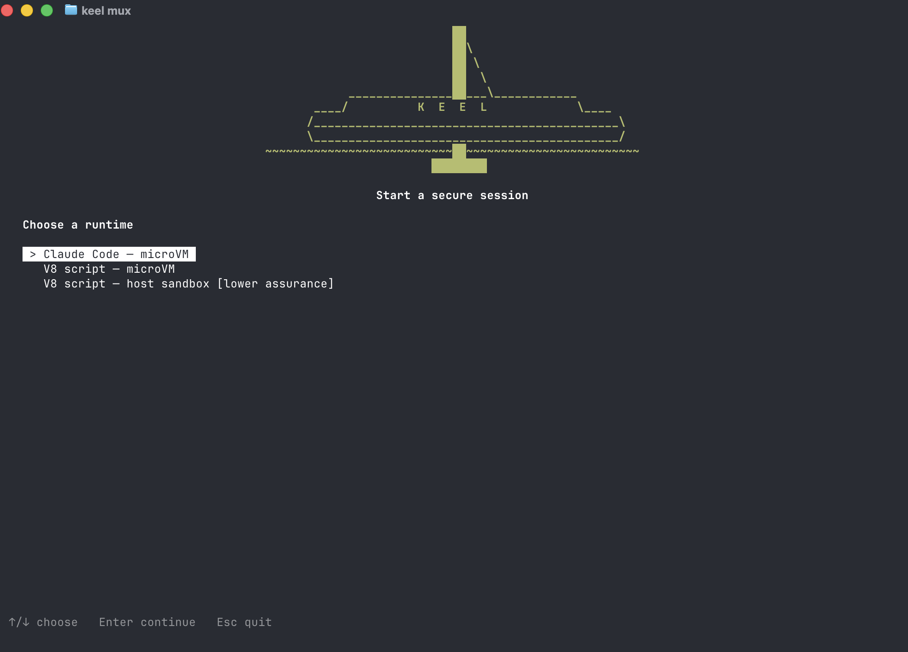

# Keel

Keel is a research prototype for running AI coding and research workloads inside a local security boundary. It treats the model, its harness, repository content, tool output, and network content as potentially hostile, then places sensitive actions behind a small trusted kernel.

Keel runs on Apple silicon macOS and on Ubuntu Linux with KVM (tested on 24.04 x86_64). It is suitable for research, evaluation, and local experimentation; it is not yet production ready.

  

## Why Keel exists

An agent can read an untrusted file or web page and then act with the authority
of the person who launched it. Keel is for the moments when that matters:

- **Working in code you don't trust:** a stranger's pull request, an unfamiliar
  dependency, a bug-report repository. Repository hooks, build scripts, and Git
  configuration can't act on your credentials unseen.
- **Letting an agent read issues and the web while it can push:** after the agent
  reads external content, a push or pull request reaches a trusted gate instead
  of going through silently.
- **Installing dependencies without exposing secrets:** install scripts never see
  your API keys or tokens; Keel adds each credential at the boundary, for one
  endpoint.
- **Reproducing a finding against its target, and nowhere else:** scoped runs
  admit only the hosts you name.
- **Leaving a run unattended:** budgets cap spend, approvals wait for you, and
  credentials stay on your machine.
- **Showing afterwards what happened:** every run ends with a signed audit chain
  and teardown receipt.

Conventional sandboxing helps, but it does not answer questions such as:

- May this particular process send data to this destination?
- Did the proposed write depend on untrusted input?
- Is an approval prompt genuine, or was it drawn by the agent?
- Can the workload use a credential without receiving the credential itself?
- Can an operator later verify what the security boundary allowed?

Keel makes those decisions outside the workload. It is not meant for CI
pipelines, multi-tenant hosting, or agents that should act without approvals.

## How it works

~~~text
operator
   |
   v
trusted input and approval UI
   |
   v
Keel kernel ── policy + provenance + budgets + audit
   |
   +── microVM (VZ on macOS, Cloud Hypervisor on Linux) ── Claude Code or Node/V8 workload
   |
   +── host V8 sandbox, macOS only ── pinned Deno process (lower assurance)
   |
   +── brokered relays ── network, Git, MCP, and credential use
~~~

The workload proposes actions. Keel reconstructs and validates those actions, rejects structurally unsafe requests, evaluates policy and provenance constraints, asks for trusted operator approval when required, lets narrow relays perform permitted actions, and records authenticated audit events. The relays transport effects but do not grant their own authority.

## Isolation profiles

| Profile | Intended use | Boundary |
| --- | --- | --- |
| Claude Code - microVM | Interactive agent sessions | A VM with no ordinary guest NIC: Virtualization.framework on macOS, Cloud Hypervisor inside bubblewrap on Linux |
| V8 script - microVM | JavaScript automation with the stronger boundary | Node/V8 inside the microVM |
| V8 script - host sandbox | Fast local JavaScript experiments, macOS only | Pinned Deno process with restricted capabilities; lower assurance and requires an explicit grant |

The two V8 profiles use the same trusted action broker, policy, provenance, budgets, and audit pipeline. They differ in where the JavaScript engine runs and therefore in the strength of the isolation boundary.

## What the guest provides

The Claude microVM guest is an Alpine Linux image with:

- **Claude Code**, with Keel's own MCP tools for pull requests and issue
  reads;
- **a headless Chromium** driven by `agent-browser`, which the agent uses
  through MCP and you can drive yourself from a guest shell. Screenshots,
  downloads, and HAR files land in `.keel-browser/` in the workspace. See
  [the guest browser](docs/USAGE.md#the-guest-browser).
- **build toolchains:** gcc, make, npm, pip, Rust, and Go, with registries
  reached through Keel's proxy. See
  [building software in the guest](docs/USAGE.md#building-software-in-the-guest).

A **scoped run** (`--profile scoped --scope RULE`) confines a run to the hosts
the operator declares and refuses everything else without a prompt, for
example to reproduce a vulnerability report against its target. `--scope none`
admits no host beyond the run's own, such as its model endpoint, for
validating a finding in code offline. See [scoped runs](docs/USAGE.md#10-scoped-runs).

## Quick start

### Install a release

A release needs no Docker or toolchain. Download the tarball for your platform,
its `.sha256`, and its `.sigstore.json` from the
[releases page](https://github.com/sand339/keel/releases) with `curl`, and the
release public key, [`keel-release.pub`](keel-release.pub), from this
repository. Check the signature first, with
[cosign](https://docs.sigstore.dev/cosign/system_config/installation/)
installed from outside the tarball, then install:

~~~sh
curl -fsSLO https://raw.githubusercontent.com/sand339/keel/main/keel-release.pub
cosign verify-blob keel-VERSION-PLATFORM.tar.gz \
    --bundle keel-VERSION-PLATFORM.tar.gz.sigstore.json \
    --key keel-release.pub
shasum -a 256 -c keel-VERSION-PLATFORM.tar.gz.sha256   # sha256sum -c on Linux
tar -xzf keel-VERSION-PLATFORM.tar.gz
./keel-VERSION-PLATFORM/install.sh                      # checks every file for damage, then installs
export PATH="$HOME/.local/bin:$PATH"
keel doctor
~~~

`cosign verify-blob` proves the tarball was signed with the maintainer's release
key and that the signature is in Sigstore's public transparency log. The
checksums only detect a damaged download: they come from the same place as the
tarball. A release published without a `.sigstore.json` is unsigned; treat it
as unverified.

On Ubuntu the host still needs KVM, your user in the `kvm` group, and
`bubblewrap` (`sudo apt-get install -y bubblewrap`). Releases are built on
Ubuntu 24.04 and need it or later.

On macOS, download with `curl` rather than a browser. Release binaries are
signed ad hoc, not notarized, so Gatekeeper refuses ones a browser marks as
downloaded.

To build from source instead:

### Requirements

On macOS:

- Apple silicon Mac
- Xcode Command Line Tools: `xcode-select --install`. If a newer beta macOS
  SDK is installed beside older tools, see
  [linking fails](docs/USAGE.md#13-common-errors).
- Docker Desktop, running during setup. It builds the guest image; it is not
  the isolation boundary.
- Rust through [rustup](https://rustup.rs); the first `cargo` command in the
  checkout installs the toolchain pinned in `rust-toolchain.toml`
- cpio, curl, git, gzip, Python 3, shasum, and tar (present on macOS with the
  Command Line Tools)
- for Bedrock, the AWS CLI v2
- about 7 GB of free disk for downloads, build caches, and the installed
  runtime, plus about 2 GB for Docker's build images

On Linux (Ubuntu; other distributions are not supported):

- an x86_64 or ARM64 host with KVM (`/dev/kvm`), your user in the `kvm`
  group; ARM64 is tested only in a nested VM
- Docker, running during setup, with your user in the `docker` group. It
  builds the guest image; it is not the isolation boundary.
- bubblewrap at `/usr/bin/bwrap`, which confines Keel's host-side children
- Rust through [rustup](https://rustup.rs), a C toolchain, `pkg-config`, and
  the libseccomp and libcap-ng headers, for building virtiofsd
- curl, git, gzip, Python 3, `sha256sum`, and tar

On Ubuntu 24.04:

~~~sh
sudo apt-get install -y build-essential pkg-config bubblewrap docker.io \
    libseccomp-dev libcap-ng-dev
sudo usermod -aG kvm,docker "$USER"    # then log in again
~~~

Ubuntu 23.10 and later also restrict the user namespaces bubblewrap needs;
`keel doctor` detects this and prints the one-line `sudo` fix.

### Build and install local runtime artifacts

~~~sh
git clone https://github.com/sand339/keel.git && cd keel
cargo run -p keel-cli --bin keel -- setup     # about 7 minutes on a first run
export PATH="$HOME/.local/bin:$PATH"          # if ~/.local/bin is not on PATH yet
keel doctor
~~~

The setup command builds the runtime, installs the launcher at ~/.local/bin/keel,
and prepares the pinned guest, V8, and xterm-headless renderer artifacts used by
the current checkout. Downloads, including every Alpine package in the guest, are version- and
SHA-256-pinned, and the guest image builds byte-identically from the same
checkout. See [pinned artifacts](docs/ARTIFACTS.md).

### Configure model access

For Anthropic API access:

~~~sh
export ANTHROPIC_API_KEY='...'
~~~

For Amazon Bedrock with AWS SSO:

~~~sh
aws sso login --profile PROFILE
export KEEL_MODEL_PROVIDER=bedrock
export AWS_REGION=us-west-2
export KEEL_AWS_CREDENTIAL_PROCESS='aws configure export-credentials --profile PROFILE --format process'
~~~

For OpenRouter (any model, priced from a snapshot you admit at launch):

~~~sh
export OPENROUTER_API_KEY='sk-or-...'
keel mux --auth openrouter --model anthropic/claude-sonnet-4.6
~~~

Signing in to Claude Code on the host does not currently transfer that SSO session into Keel. Use an Anthropic API key, OpenRouter, or the Bedrock configuration above.

### Start a session

~~~sh
keel mux
~~~

The launcher asks for a runtime and workspace. V8 workloads also require a JavaScript entry file relative to the selected workspace.

Per-run model ceilings default to 1,000,000 tokens and USD 20.00. Override
them with `--model-token-budget TOKENS` and `--model-cost-budget USD`; elevated
ceilings require confirmation on the trusted task-admission screen.

Direct V8 examples:

~~~sh
# Recommended: V8 inside the microVM
keel run --isolation vm-v8 v8 docs/examples/v8-smoke.mjs

# Lower-assurance host sandbox; the explicit grant is intentional
keel run --isolation v8-sandboxed \
  --allow isolation:v8-sandboxed \
  v8 docs/examples/v8-smoke.mjs
~~~

The trusted terminal requires a second, exact `HOST V8` confirmation before the
lower-assurance process starts.

## Security posture

| Prevents | Gates on operator approval | Records only (shadow) |
| --- | --- | --- |
| Credentials reaching the guest | Egress to unadmitted hosts | Task intent outside branch scopes |
| Guest networking; link-local, loopback, and private destinations | Pushes and PRs outside a branch scope or from workspace code | Per-turn model context |
| Admitted secrets leaving | Actions below the provenance floor | Action-centric decision verdicts |
| `deny:` rules, and anything outside a scoped run | Private content to an uncleared destination | Every permitted action, in the audit chain |
| Renderer-drawn approvals; guest writes to the audit log | Unaccounted lines in protected files of a push; floor lifts | |

| Property | Tests |
| --- | --- |
| Credentials stay on the host; the guest gets sentinels | [`credential_scope.rs`](crates/trusted/keel-secrets/tests/support/credential_scope.rs), [`openrouter.rs`](crates/trusted/keel-secrets/tests/openrouter.rs) |
| No guest NIC; each request is brokered and authorized after TLS termination | [`relay.rs`](crates/untrusted/keel-isolate/src/relay.rs), [`provenance_gate.rs`](crates/trusted/keel-kernel/tests/provenance_gate.rs) |
| A second confinement layer in the guest: no capabilities, Landlock, seccomp, cgroup | [`keel-mcp`](crates/untrusted/keel-mcp/src/lib.rs) `confinement_preflight_requires_every_layer` |
| Each request names the guest process behind it | [`push_provenance.rs`](crates/trusted/keel-kernel/tests/push_provenance.rs) |
| Policy, provenance, budgets, and approval combine | [`primary_scenario.rs`](crates/trusted/keel-policy/tests/primary_scenario.rs), [`write_inheritance.rs`](crates/trusted/keel-provenance/tests/write_inheritance.rs), [`model_budget.rs`](crates/trusted/keel-kernel/tests/model_budget.rs) |
| Approval input is isolated from the renderer | [`secure_attention.rs`](crates/trusted/keel-input/tests/secure_attention.rs) |
| `A` approves one action once; `G` grants are scoped and expire | [`egress_grant_scope.rs`](crates/trusted/keel-kernel/tests/egress_grant_scope.rs) |
| Scoped runs refuse everything outside their scope | [`scoped_run.rs`](crates/trusted/keel-input/tests/scoped_run.rs) |
| Every run records its admission manifest first | [`admission_manifest.rs`](crates/trusted/keel-input/tests/admission_manifest.rs) |
| The audit log is authenticated, hash-chained, and sealed | [`verification_status.rs`](crates/trusted/keel-audit/tests/verification_status.rs) |
| The trusted code is about 19,700 lines, each crate held to a line ratchet | [`check_invariants.py`](ci/check_invariants.py) I1 |

Out of scope: judging whether an action is harmful, stopping an operator from
approving an accurately shown action, exfiltration through permitted output,
and a compromised host, hypervisor, or trusted dependency. See the
[threat model](docs/THREAT-MODEL.md).

## Known limitations

- **Payload checks are verbatim:** paraphrased or re-encoded content is not detected.
- **Extraction is schema-bounded:** tasks that need an issue's prose still read it raw.
- **Shadow verdicts:** task intent and per-turn context are measured, not enforced.
- **HTTP/1.1 only:** WebSocket upgrades close at the first frame.
- **Chromium updates with the package lock,** and runs without its own sandbox inside the VM.
- **No live browser view:** use the `agent-browser` CLI and its screenshots.
- **Platforms:** Apple silicon macOS and Ubuntu 24.04+ (x86_64; ARM64 tested only nested); host V8 is macOS-only.
- **Crash cleanup:** a killed runtime's VM stops with it on both platforms, but its scratch directories wait for `keel recover`, the next `keel run` or `keel attach` (after a 15-minute grace), or the opt-in hourly reaper, and recovery records are unsigned.
- **Process attribution is the guest's claim:** which guest process issued a push comes from the guest's PID 1, read just after each exec; it can only add a gate, never remove one.
- **Unsigned releases:** a release without a `.sigstore.json` bundle is unsigned; none is signed yet.

## Documentation

| Document | Purpose |
| --- | --- |
| [Usage](docs/USAGE.md) | Installation, credentials, sessions, approvals, audit, and troubleshooting |
| [Architecture](docs/ARCHITECTURE.md) | Components, trust boundaries, action flow, and code map |
| [Threat model](docs/THREAT-MODEL.md) | Assets, adversaries, intended guarantees, assumptions, and residual risks |
| [Roadmap](docs/ROADMAP.md) | Future work only, with links to detailed design notes |
| [Pinned artifacts](docs/ARTIFACTS.md) | Every downloaded artifact, its source and pin, and how to update it |
| [Documentation index](docs/README.md) | Design notes, examples, and historical project material |
| [Security policy](SECURITY.md) | Private vulnerability reporting, scope, and response process |
| [Contributing](CONTRIBUTING.md) | Development workflow and trust-boundary rules |

## Project status

The repository contains working microVM and V8 execution paths, policy enforcement, a conservative session-wide provenance floor, trusted approvals, credential-aware relays, process attribution, an audited admission manifest, session management, checked teardown with a signed stop receipt, crash recovery from the audit chain, and authenticated audit logs. The action-centric verdicts and the per-turn context digest log run in shadow mode while their data is measured. Remaining work includes enforcement of those verdicts, a published security evaluation, Linux and VM tests in CI, and host V8 on Linux (see the [roadmap](docs/ROADMAP.md)).

Security-sensitive behavior should be judged from the current source, tests, and threat model—not from roadmap items or design proposals.

## License

Keel is licensed under the [Apache License 2.0](LICENSE). Embedded dependency
attributions are listed in [Third-party notices](THIRD_PARTY_NOTICES.md).
